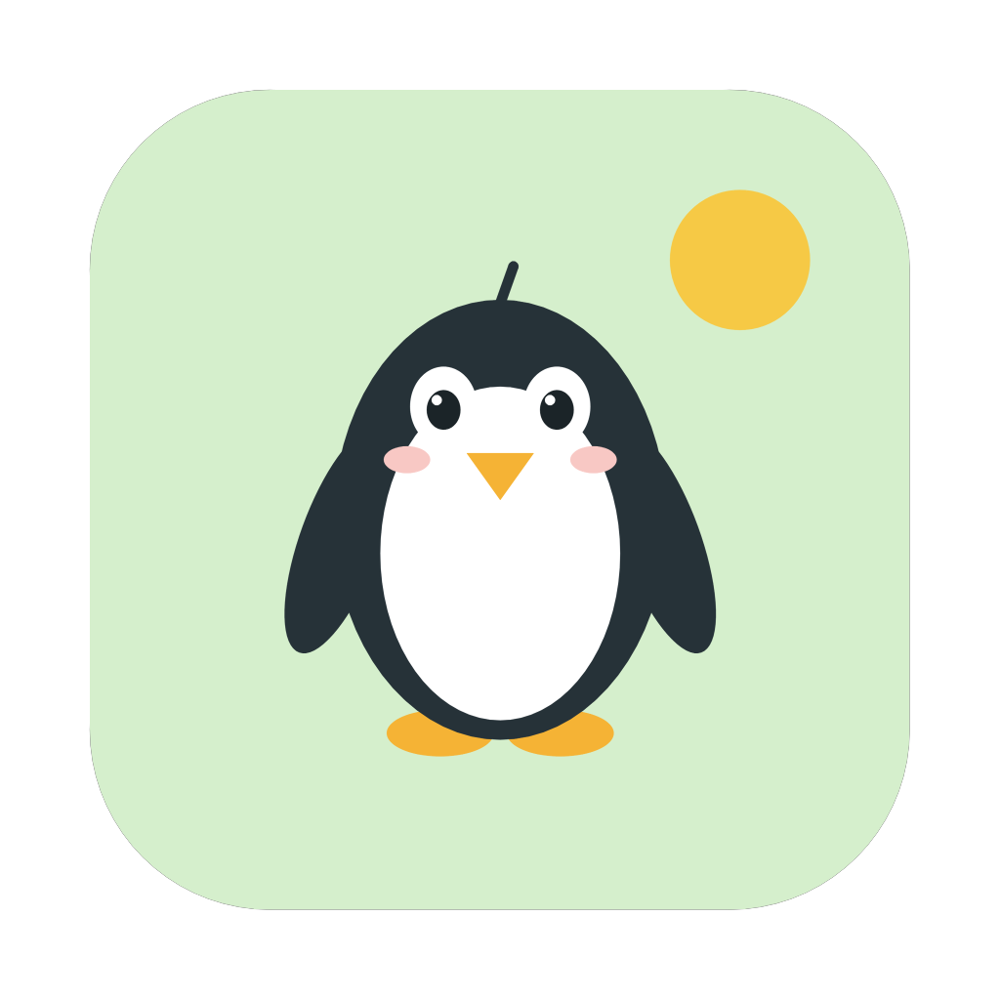

# Mosign



A Python program that uses your webcam to control a web browser with hand gestures. You can scroll up and down, stop scrolling, and switch tabs without touching the keyboard or mouse.

## How it works

1. **MediaPipe Hands** finds 21 landmark points on your hand in each webcam frame.
2. The program checks which fingers are extended (a finger counts as "up" when its tip is farther from the wrist than its middle joint).
3. The pattern of raised fingers is matched to a gesture.
4. **PyAutoGUI** sends the matching scroll or keyboard action to the active window.

A gesture must be held steady for a few frames before it counts, which prevents accidental triggers.

## Gestures

Point your index finger the way you want to go (other fingers curled, thumb either way).

| Gesture | Action |
|---|---|
| Point up | Scroll up (keeps going while you point) |
| Point down | Scroll down (keeps going while you point) |
| Point left | Previous tab (Ctrl+Shift+Tab) |
| Point right | Next tab (Ctrl+Tab) |
| Rock horns (index + pinky), hold 1 second | Turn tracking off / back on |
| Pinky up (only the pinky), hold 1 second | Hide / show the gesture menu |
| Anything else / lower your hand | Stop / no action |

The camera view is mirrored, so "left" means your left.

While tracking is off, only the rock-horns gesture is watched for, so you can rest your hands or talk with them freely.

## Quick tour (first run)

The first time you open Mosign it walks you through every control: show your hand, point up, down, left and right, hide and show the menu, then pause and resume tracking. Each step only finishes when you actually do the gesture, so by the end you've used every control at least once.

During the tour the app is in **practice mode**: gestures are recognised and Pip reacts, but nothing is sent to your browser. When you finish, gestures go live and the tour won't appear again. Replay it any time with `O` or **Tour**.

If your camera can't see you and you need to get past the tour, start the app with `--skip-tour`.

## The app window

Mosign has two parts:

- **The on-screen overlay**, in the top-right corner of your screen and floating above every other app, including your browser. It holds **Pip the penguin**, who copies what you do: hops up while you scroll up, slides down while you scroll down, waddles left or right when you switch tabs, waves when you toggle the menu, and naps while tracking is paused. Below Pip is the **Gestures** menu, which shows every gesture with a small animated hand and lights up the one you're doing. Hold your pinky up for 1 second to hide or show the menu (Pip stays). Clicks go straight through the overlay, and it never takes focus away from your browser. It also shows over full-screen apps; if it doesn't on your Mac, start Mosign once with `--hide-dock-icon` (remembered; `--show-dock-icon` undoes it).
- **The Mosign window**, a light-green window that shows your camera with your hand's skeleton drawn on top, plus a "Right now" card that says which gesture it sees. This is also where the quick tour runs. You can move it out of the way or minimise it; closing it quits Mosign.

| Key / button (in the Mosign window) | Action |
|---|---|
| `C` / **Camera** | Switch to the next working camera (remembered next time) |
| `S` / **Pause** | Pause or resume tracking |
| `M` / **Hide menu** | Hide or show the gesture menu in the overlay |
| `O` / **Tour** | Run the quick tour again (or end a replayed tour) |
| `Q` / **Quit** | Quit |

Settings are saved in `~/.mosign/config.json` (camera, scroll speed, hold time, etc.).

## Requirements

- macOS (Intel or Apple Silicon)
- Python 3.12 recommended (3.9+ works; Mosign supports both the old and the new MediaPipe API)
- A webcam

## Setup

```bash
cd path/to/project-folder
python3.12 -m venv gestures
source gestures/bin/activate
python -m pip install --upgrade pip
python -m pip install -r requirements.txt
```

Check that the environment uses the right version:

```bash
python --version
```

It should print `Python 3.12.x`.

On Intel Macs, `requirements.txt` automatically installs MediaPipe 0.10.14, because newer Intel builds need packages that have to be compiled.

## macOS permissions

Go to **System Settings > Privacy & Security** and enable your terminal app (Terminal, iTerm, or VS Code) under:

- **Camera**
- **Accessibility**

Quit and reopen the terminal afterward.

## Run

```bash
source gestures/bin/activate
python gesture_control.py      # or: python -m mosign
```

With newer MediaPipe versions, the first run downloads a small hand model (about 8 MB) to `~/.mosign/models`.

Click on your browser window so it is the active window, then show your gestures to the camera.

Press `Q` in the Mosign window to quit, or `Ctrl+C` in the terminal.

Options: `--camera N` (start with camera N), `--tour` (replay the tour), `--skip-tour`, `--hide-dock-icon` / `--show-dock-icon` (macOS), `--self-test`.

**Emergency stop:** move your mouse into a corner of the screen (PyAutoGUI failsafe).

## Share it as an app (no Terminal needed)

Build a double-clickable `Mosign.app` plus a `.dmg` installer that bundles Python and every library, so the people you share it with don't install anything:

```bash
./scripts/build_mac.sh
```

See [PACKAGING.md](PACKAGING.md) for details, the Windows build, and the permission steps to tell users about.

## Development

```bash
python -m pip install -r requirements-dev.txt
python -m pytest -q                 # tests (no camera needed)
python scripts/preview_ui.py        # render the window to build/preview/*.png
python -m mosign --self-test        # check the install
```

Code layout: `mosign/gestures.py` (gesture rules), `controller.py` (gestures to actions), `onboarding.py` (tour), `engine.py` (one frame: camera to actions to pictures), `ui.py` (main window picture), `overlay.py` (overlay picture with transparency), `penguin.py` / `icons.py` (drawing), `qt_app.py` / `macos.py` (the actual windows), `tracker.py` (MediaPipe), `camera.py`, `config.py`, `app.py` (start-up).

